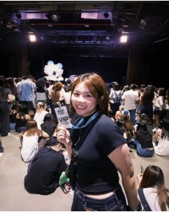
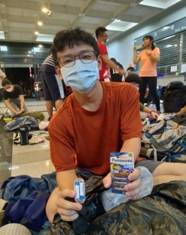
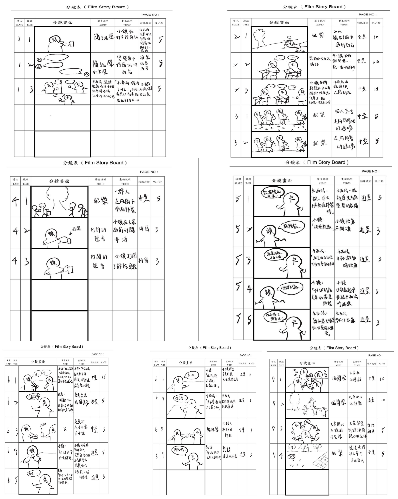

<!DOCTYPE html>
<html lang="zh-Hant">
<head>
    <meta charset="UTF-8">
    <meta name="viewport" content="width=device-width, initial-scale=1.0">
    <!-- SEO Meta 標籤設定 -->
    <title>甲五 Sober Picnic｜無酒精永續野餐 - 官方網站</title>
    <meta name="description" content="甲五團隊打造的新型態無酒精永續野餐（Sober Picnic）。結合清醒社交、低碳無痕生活與Z世代體驗經濟，無痕野餐，無酒也歡！">
    <meta name="keywords" content="Sober Picnic, 無酒精派對, 無痕野餐, 永續社交, Z世代, 低碳生活, 甲五團隊">
    <meta property="og:title" content="甲五 Sober Picnic｜無酒精永續野餐">
    <meta property="og:description" content="清醒也能盡興！專為Z世代打造的健康、低碳與無壓力的戶外野餐派對。">
    <meta property="og:type" content="website">
    
    <!-- 從本 HTML 的所在資料夾出發，進入 css 資料夾，再讀取 style.css 檔 -->
   <link rel="stylesheet" href="css/project1.css">
</head>
<body>

<!-- 頂部固定導覽列 (Navbar) -->
<header id="top">
    

        

            <a href="#top">🌱 Sober Picnic</a>
        

        <nav aria-label="全站主選單" class="main-nav">
            <ul>
                <li><a href="#intro">品牌理念</a></li>
                <li><a href="#highlights">企劃亮點</a></li>
                <li><a href="#analysis">現況與競品</a></li>
                <li><a href="#persona">目標客群</a></li>
                <li><a href="#story">廣告概念</a></li>
                <li><a href="#team">甲五團隊</a></li>
            </ul>
        </nav>
    

    
    

        <h1>甲五 Sober Picnic</h1>
        
<small>無痕野餐 · 無酒也歡 · 永續社交</small>

        
<strong>打破傳統酒精文化壓力，打造兼具健康、低碳與自在交流的新社交體驗。</strong>

        
本期焦點：<mark class="reading-focus">清醒派對 (Sober Party) × 無痕飲食文化</mark>

        
專案團隊：甲五團隊｜指導老師：丁美靜、王婉禎、李悅端、李律鋒｜整理日期：<time datetime="2026-11-11">2026 年 11 月 11 日</time>

    

</header>

<!-- 頁內快速跳轉導覽 (Sub-Nav / Directory) -->
<nav aria-label="報導目錄" class="quick-nav">
    <h2>專案目錄導覽</h2>
    <ul>
        <li><a href="#intro">一、專案執行摘要</a></li>
        <li><a href="#highlights">二、企劃核心與參觀重點</a></li>
        <li><a href="#analysis">三、現況與競品分析表</a></li>
        <li><a href="#swot">四、SWOT 與 SO 策略</a></li>
        <li><a href="#persona">五、Z 世代 Persona 客群</a></li>
        <li><a href="#positioning">六、十字定位矩陣</a></li>
        <li><a href="#story">七、故事大綱與廣告劇本</a></li>
        <li><a href="#team">八、甲五團隊與組員心得</a></li>
    </ul>
</nav>

<main id="main-content">
    <article aria-label="Sober Picnic 企劃全貌報導">
        
        <!-- Section 1: 專案執行摘要 -->
        <section id="intro">
            <h2>一、專案執行摘要</h2>
            

                在當前多數聚會仍仰賴酒精與一次性用品的社交文化中，我們希望打造一種兼顧<strong>健康、永續與自在交流</strong>的新聚會型態。
                本專案以「無酒精永續野餐」為主軸，結合 <strong>sober party</strong> 與無痕野餐理念，引導參與者透過自備環保餐具、使用在地食材與健康無酒精飲品實踐低碳生活。
            

            

                根據行政院環保署統計，台灣每年使用超過 40 億個一次性餐具與飲料容器。同時全球年輕世代（Gen Z）中有超過 60% 開始實踐「有意識消費（mindful consumption）」。
                我們以「永續行動 × 健康社交」作為差異化切入點，提供市場上較少見的低壓力、可實踐、且具理念深度的參與形式。
            

            
<strong>活動主題：</strong>甲五 Sober Picnic 無痕野餐。 <strong>核心口號：</strong>無痕野餐，無酒也歡。

        </section>

        <!-- Section 2: 企劃核心重點 -->
        <section id="highlights">
            <h2>二、企劃核心與參觀重點</h2>
            <h3>值得留意的三個核心特色</h3>
            <ul>
                <li><strong>無酒精清醒社交：</strong>以無酒精氣泡水、鮮果茶取代酒精，營造真誠、安全且沒有乾杯壓力的交流氛圍。</li>
                <li><strong>無痕低碳實踐：</strong>鼓勵自備環保餐具與容器，選用在地食材，顯著降低活動碳足跡與浪費。</li>
                <li><strong>自然場域療癒：</strong>於綠意盎然的戶外草地舉辦，結合音樂與輕社交，提供情緒放鬆的療癒空間。</li>
            </ul>

            <h3>建議活動參與順序</h3>
            <ol>
                <li>騎乘單車或搭乘大眾運輸抵達草地公園，實踐低碳交通。</li>
                <li>鋪開重複使用的野餐墊，擺放自備的環保餐具與餐盒。</li>
                <li>開瓶享用手作無酒精水果氣泡水，感受清新氣泡口感。</li>
                <li>參與草地飛盤與輕音樂互動，在清醒狀態下拍照記錄美好時光。</li>
            </ol>
        </section>

        <!-- Section 3: 現況與競品比較表 -->
        <section id="analysis">
            <h2>三、現況與競品分析表</h2>
            <table>
                <caption>Sober Picnic 與台中熱門活動競品比較</caption>
                <thead>
                    <tr>
                        <th scope="col">活動名稱</th>
                        <th scope="col">活動形式</th>
                        <th scope="col">核心吸引力</th>
                        <th scope="col">社交門檻</th>
                    </tr>
                </thead>
                <tbody>
                    <tr>
                        <th scope="row">Sober Picnic (我們)</th>
                        <td>野餐體驗 + 無酒精吧 + 遊戲互動</td>
                        <td>無酒精清醒文化 + 無痕永續生活融入</td>
                        <td>低壓力（無飲酒負擔，互動輕鬆）</td>
                    </tr>
                    <tr>
                        <th scope="row">草悟系市集</th>
                        <td>主題市集 + 攤位 + 音樂展演</td>
                        <td>都市綠生活、夜市與選物混合型態</td>
                        <td>中等（較依賴店家營造購物氛圍）</td>
                    </tr>
                    <tr>
                        <th scope="row">審計新村市集</th>
                        <td>文創手作 + 二手選物 + 工作坊</td>
                        <td>文創品牌孵化、特色手作體驗</td>
                        <td>中等（偏消費導向社交）</td>
                    </tr>
                    <tr>
                        <th scope="row">台中文創園區</th>
                        <td>環保主題 + 展覽 + 講座體驗</td>
                        <td>藝術展覽、環境教育議題</td>
                        <td>較高（偏靜態學習與展覽）</td>
                    </tr>
                </tbody>
            </table>
        </section>

        <!-- Section 4: SWOT 分析 -->
        <section id="swot">
            <h2>四、SWOT 與 SO 策略矩陣</h2>
            

                

                    <h3>Strengths (優勢)</h3>
                    
1. 無酒精派對帶帶來清醒、真誠且安全的社交氛圍。 2. 融入減塑與低碳設計，切合 ESG 與永續精神。 3. 戶外自然場域有效釋放都市壓力。

                

                

                    <h3>Weaknesses (劣勢)</h3>
                    
1. 初期資金與行銷資源有限，需進行市場教育。 2. 大眾對「無酒精派對」的概念尚在建立階段。

                

                

                    <h3>Opportunities (機會)</h3>
                    
1. 政府積極推廣 SDGs 與 ESG 政策補助。 2. Z 世代健康意識抬頭，無酒精飲品市場年增 7% 以上。 3. 體驗經濟與高社群分享意願。

                

                

                    <h3>Threats (威脅)</h3>
                    
1. 戶外場地申請、噪音與安檢法規嚴格。 2. 綠色永續餐具與設備初期投入成本較高。

                

            

            
<strong>SO 策略：</strong>結合 S1 無酒精社交與 O2/O5 健康意識，打造低壓、理性的新派對模式；結合 S2 低碳環保與 O1/O6 政府補助與社群擴散，極大化品牌永續形象。

        </section>

        <!-- Section 5: Target Audience Persona (Grid 網格展示) -->
        <section id="persona">
            <h2>五、Z 世代 Persona 目標客群</h2>
            
本企劃鎖定 13-28 歲 Z 世代族群，他們具備高度永續敏感度，且渴望無壓力的真實社交。

            

                

                    <figure class="persona-fig">
                        
                    </figure>
                    <h3>蔡欣儒 (25歲 / 公司行政)</h3>
                    
<strong>個性：</strong>自律、有邊界感、健康控

                    
<strong>痛點：</strong>聚會常被逼問「怎麼不喝酒？」，感到社交壓力。

                    
<strong>動機：</strong>期待安心舒服的戶外無酒精野餐。

                

                

                    <figure class="persona-fig">
                        
                    </figure>
                    <h3>林鈺涵 (18歲 / 大學生)</h3>
                    
<strong>個性：</strong>慢熟型、觀察細膩、自備餐具

                    
<strong>痛點：</strong>學生活動多以玩樂為主，缺乏有質感的社交。

                    
<strong>動機：</strong>尋找不用假裝社交、能做自己的質感圈子。

                

                

                    <figure class="persona-fig">
                        
                    </figure>
                    <h3>吳濬丞 (23歲 / 超商店員)</h3>
                    
<strong>個性：</strong>外向健談、活力派、戶外愛好者

                    
<strong>痛點：</strong>多數聚會過度仰賴酒精炒氣氛。

                    
<strong>動機：</strong>想開懷大玩又不需要硬喝的團康派對。

                

            

        </section>

        <!-- Section 6: 市場定位分析 -->
        <section id="positioning">
            <h2>六、十字定位矩陣分析</h2>
            
我們以「環保永續性」為縱軸、「社交性」為橫軸進行十字定位：

            

                
🌱 甲五 Sober Picnic 位於右上象限：高永續 × 高社交

                
精準切中 Z 世代「想放鬆社交，但不想喝酒、不想不合群」的真實心聲。提供兼具理念深度與生活感的健康社交新模式。

            

        </section>

        <!-- Section 7: 廣告概念與分鏡大綱 -->
        <section id="story">
            <h2>七、故事大綱與廣告劇本</h2>
            <h3>廣告標語：無痕野餐，無酒也歡</h3>
            

                一群朋友在群組相約週末騎單車野餐。原本擔心會充斥酒精與垃圾，然而到了現場，大家手提環保袋與可重用餐具。
                當打開瓶蓋時，發現不是酒而是清爽的水果氣泡水！大家開心地玩飛盤、拍照自拍，在夕陽下共享健康自然的時光。
            

            <figure>
                
                <figcaption>廣告影片概念：朋友共享清爽水果氣泡水與無痕野餐。</figcaption>
            </figure>
        </section>

        <!-- Section 8: 甲五團隊與組員心得 -->
        <section id="team">
            <h2>八、甲五團隊與組員心得</h2>
            

                

                    <h3>蔡欣妘（組長 / 行銷二甲）</h3>
                    
第一次擔任組長學到了很多行程安排與溝通技巧，謝謝甲五大家一起完成影展！

                

                

                    <h3>呂品依 & 林子淇（企劃組）</h3>
                    
挑戰企劃職位收穫滿滿，不斷吸收新觀點，很高興能一起做出不留遺憾的作品。

                

                

                    <h3>洪婷鈺（編劇）</h3>
                    
體會到故事的力量，看到文字劇本轉化為實際畫面讓人非常感動！

                

                

                    <h3>劉欣潓（導演攝影）</h3>
                    
初次嘗試導演角色與分鏡修改，感受團隊團結一致呈現最佳模樣的力量。

                

                

                    <h3>錢奕靜（美術）</h3>
                    
負責封面與視覺設計雖然緊張，但最終順利完成並學到了許多視覺美感細節！

                

                

                    <h3>高銘鴻（音樂剪輯）</h3>
                    
背負整個團隊的心血進行最後收尾剪輯，雖然有壓力但讓剪輯技術更上一層樓，甲五缺一不可！

                

                

                    <h3>林恩駿（劇務）</h3>
                    
體會到劇務的不可或缺，頂著大太陽完成拍攝，感謝每一位夥伴的辛勤付出。

                

            

        </section>

        <!-- 參觀提醒 Aside -->
        <aside id="tips" aria-labelledby="tips-title">
            <h2 id="tips-title">🌿 無痕野餐的小提醒</h2>
            

                
參加 Sober Picnic 請記得這三件事

                <ul>
                    <li>自備環保餐具、水壺與重複使用的野餐墊。</li>
                    <li>準備手作氣泡飲或鮮果茶，體驗清醒暢飲的樂趣。</li>
                    <li>離開前將隨身物品與少量垃圾全數帶走，保持草地乾淨。</li>
                </ul>
            

        </aside>

        <!-- 參考資料 -->
        <section id="sources">
            <h2>九、資料來源與參考文獻</h2>
            <ul>
                <li>行政院環境保護署資源循環署 (2024)：一次性餐具與容器使用統計。</li>
                <li>GlobalData (2024): Mindful Consumption Trends in Asia-Pacific.</li>
                <li>Drinkaware (2025): Youth Drinking Trends & Non-Alcoholic Choices.</li>
                <li>PubMed (2021): Non-drinkers' experiences of social situations involving alcohol.</li>
            </ul>
        </section>
    </article>
</main>

<footer>
    
<strong>甲五 Sober Picnic 企劃官方網站</strong>

    
<small>逢甲大學行銷學系 甲五團隊製作 · 更新日期：2026 年 11 月 11 日</small>

    
<small>© 2026 Sober Picnic Project. All rights reserved.</small>

    
<a href="#top">回到頁首 ↑</a>

</footer>

</body>
</html>
